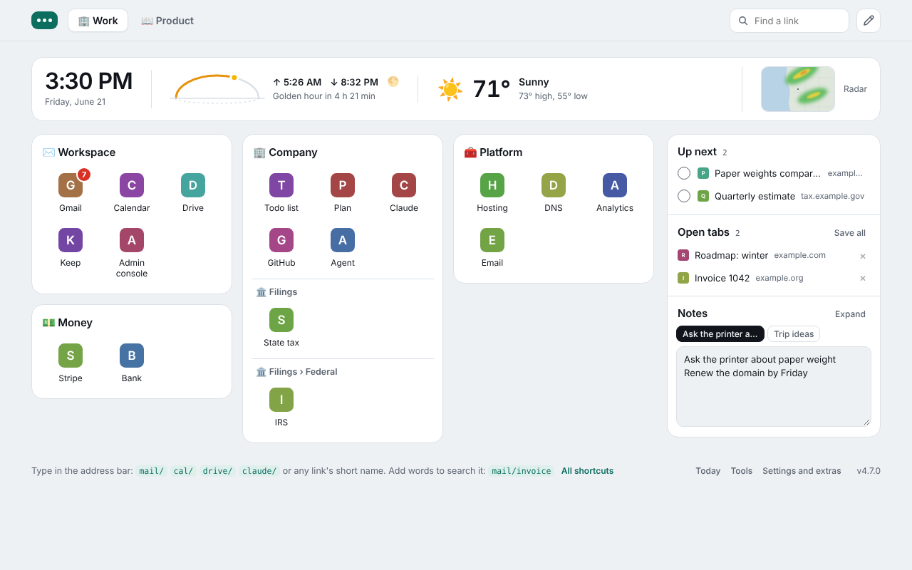
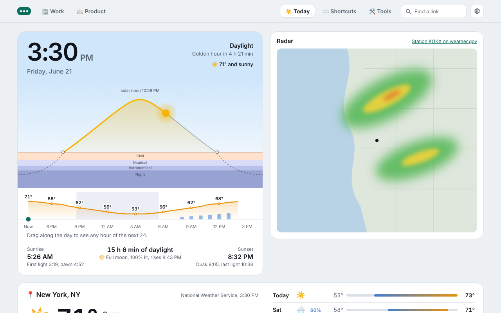
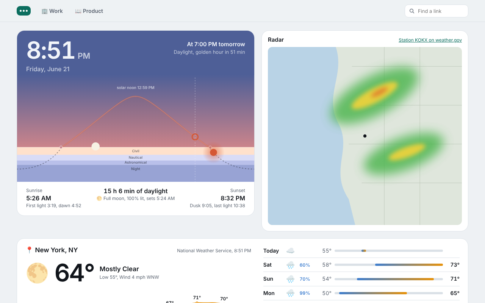
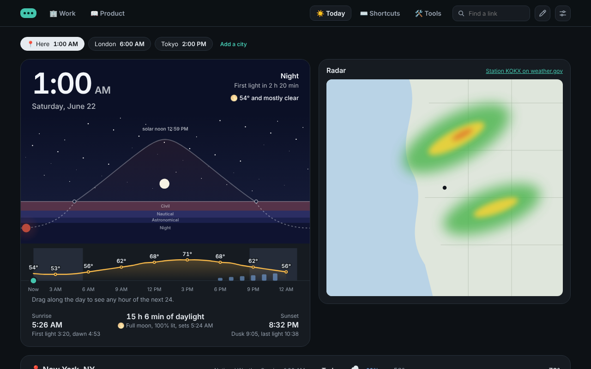

# New Tab

**Your bookmarks are already organised. This makes them your new tab.**

A new tab page for Chrome, drawn live from your bookmarks bar. Every folder on the bar is a tab;
every folder inside it is a card of icons. Type `mail/`, `stripe/refund policy` or
`claude/what should I ask` in the address bar and go. Look up and see the sun where it really is.

Nothing to import. No account. Remove it and you have lost nothing.



## Why it exists

Launchers and tab managers usually want your links moved into them: a sign-up, an import that
is out of date by the next morning, a second place to keep tidy, and a paid plan once you depend
on it. Meanwhile your browser already has a link store that syncs to every computer you use, is
backed up with your profile, and is readable by every other tool you own. You have been using
it for years.

This page adds a face to that store and keeps nothing of its own:

- **Your links stay Chrome bookmarks.** Drag a tile here and the bookmarks bar changes. Bookmark
  a page anywhere and it appears here.
- **No lock-in, because there is nothing to export.** Uninstall it and every link is where it
  always was.
- **No account, no server, no analytics.** There is nobody on the other end.
- **Lean on purpose.** One page of plain JavaScript, no framework, no build step. It draws from
  what it has saved and never makes you wait for the network.
- **Free and open source.**

## What you get

**Launch**
- **Spaces and collections.** A bar folder is a space (Work, a client, a product). A folder in
  it is a collection: a card of icon tiles. A folder inside *that* is a headed group in the card.
- **Drag to reorder** tiles, cards and space tabs. It is your bookmarks moving, so the order
  holds everywhere.
- **Open all** opens a collection as one named tab group.
- **Find** (the box at the top, or `/`) filters everything you keep, whichever space it is in,
  and the tabs open in this window. While something is typed the matches stand in for the
  page, best first, each with where it lives and its short name. Enter opens the first; with
  no match, Enter searches the web; Esc puts the page back. A short link typed there
  (`claude/what to ask`) goes where it would from the address bar, and Today, Shortcuts, Tools
  and Settings are found there by name.
- **The bar is your links.** The mark at the top left is a menu holding Today, Shortcuts, Tools,
  and Settings and extras; the rest of the bar is your spaces, the search and the pencil. The
  weather strip opens Today, and Today and Tools are in the footer too.
- **Tiles or a list.** Settings shows links as icon tiles or as rows, which fit more in a card
  and show each link's short name beside it.
- **The pencil** (top right) turns on editing: add a space, a collection, a group or a link;
  click a name to rename any of them; remove in place, with Undo. Naming a folder offers a row
  of emoji to lead it with, which is what a crowded top bar keeps of the name.
- **Three ways to bring links in,** on a bare bookmarks bar and in Settings any time: a starter
  set; a bookmarks file from another browser; or a prompt to paste into the assistant you use,
  which asks what you do and writes that file for you. Only web links are taken from a file,
  and nothing already there is added twice.

**Type, don't click**
- **Every bookmark gets a short name** from its own name, the moment it is bookmarked:
  `stripe/`, `github/`. Nothing to set up; click one to change it.
- **Words after the slash search the site itself** where this page knows how: about thirty
  well-known sites, bookmarked or not, among them `translate/buenos días` (into Google
  Translate), `maps/coffee near me`, `yt/`, `wiki/`, `gh/`, `gpt/`, `pplx/`, `amazon/`,
  `reddit/`. A bookmark on one of those sites searches it whatever you named it. Any other
  (`stripe/refund policy`, `chipotle/`) searches the web for that site, since most sites have
  no search an address can reach. Shortcuts you add yourself put the words wherever you say,
  with `%s`.
- **Google's apps and Claude are always there,** bookmarked or not, and search inside
  themselves: `mail/invoice from the printer`, `cal/dentist`, `drive/contract`,
  `docs/board minutes`, `sheets/budget`, `slides/pitch`, `keep/gift ideas`,
  `claude/draft a reply to this`. Or type `claude`, press Tab, and ask.
- **Chrome's own pages have names too:** `history/that recipe`, `downloads/invoice`,
  `bookmarks/tax`, `settings/cookies`, `extensions/`, `passwords/`. A bookmark with the same
  name wins.

**Pick up where you left off**
- **Up next:** pages to come back to, in order. One click on the toolbar button, Alt+Shift+S,
  or a right-click on any page or link. It is a bookmarks folder, so it syncs too.
- **Open tabs:** switch to one, reorder the tab strip, close one (× or a middle click), or drag
  one into a collection.
  **Save all** files the whole window.
- **Notes:** a scratch box that follows your Chrome profile. Expand lifts it into a big box,
  where it can be a few pages, copied or downloaded.

**Look up**
- **The sky, drawn to scale.** The sun's real path for today with solar noon in the middle, the
  civil, nautical and astronomical twilights under the horizon, and the moon where it stands, lit
  on the side that faces the sun.
- **One clock to point at.** Point along the sky or the hourly forecast and both move to that
  moment: the sun's path marks where the sun will be, the hours mark the hour, and the top of
  the sky says the time, the light, how long until it changes and, within the next day, the
  weather then.
- **The page goes dark when night falls** where you are, and light again at dawn. Settings can
  hold it light or dark, and has four accent colours.
- **Forecast and radar** from the National Weather Service: now, the next 24 hours, seven
  days, and the radar loop beside the sky. A strip across the top of every space carries the
  short version on one line: the
  time, the sun's arc with sunrise, sunset and the moon's phase, the temperature and a radar
  still. Its time and date open your calendar.

**Check, when you want to**
- **Tools** is a tab that shows how this connection and this browser look from outside. Opening
  it runs the check; no other part of the page makes these calls.
  - **Where you come out**, as a sentence and a map: your place, the city your traffic leaves
    from, and the way round the world between them. Then one line that counts what needs
    fixing, and four answers in plain words: your provider, your clock, video calls (WebRTC)
    and name lookups (DNS). Each says what it is, what was found, what that means, and what
    to do, which is often nothing and says so. A sign is kept for what matters and can be
    acted on: red for your real address getting out, amber for something going around a VPN.
  - **Fingerprint** draws the mark a tracking script would know this browser by, worked out on
    your computer, lists what it is made of in plain words, by how far each thing narrows
    you down, and says what can and can't be done about it.
  - **What each kind of tool would change:** a VPN, secure DNS, a tracker blocker, a private
    window, each with what it does and what it doesn't. Kinds, not products: nothing is named,
    ranked or linked for money.
  - **Speed** reads download, upload and delay onto bars, says what that is good for in a
    household's terms, and what to try when it is poor. It waits for a press, because it
    spends data.
  - **Chrome's privacy switches** reads how Chrome itself is set, puts what is worth a look
    first, and takes you to the page that changes each one. It can also narrow the route WebRTC
    may take, which Chrome has no switch for.

| Day | Dusk | Night |
|---|---|---|
|  |  |  |

Screenshots use sample bookmarks, a made-up forecast and a stand-in radar frame. With real
bookmarks the tiles show each site's own icon; a site without one gets its initial, as here.

## Install

**From a release (two minutes)**

1. Download `newtab-<version>.zip` from the [latest release](../../releases/latest) and unzip it
   somewhere it can stay, such as your Documents folder.
2. Open `chrome://extensions` and switch on **Developer mode** (top right).
3. Click **Load unpacked** and choose the unzipped folder.
4. Open a new tab. Chrome asks once whether to keep the new page: keep it.

To update, replace the folder's contents with the new release and click ↻ on the extension.

**From source:** clone this repository and load the `extension` folder the same way.

**For a team on Google Workspace:** once it is on the Chrome Web Store (public, unlisted or
private to your domain), force-install it by its ID in the Admin console under Chrome → Apps &
extensions. Pair it with managed bookmarks and every new hire opens a new tab onto the
company's tools. The listing text and assets are in [`store/`](store/listing.md).

New Tab is built and tested on Chrome 120 and later. Other Chromium browsers are untested.

## Getting started

There is no setup screen and no guide to click through. If you already keep folders on your
bookmarks bar, a new tab is them. If you don't, the page says so where your links will go and
offers the ways in. Four things make it yours:

1. **Bring in your links.** The page is your bookmarks bar, laid out: each folder on the bar
   is a tab at the top, each folder inside it a card of links. With nothing there yet, pick
   one of three ways in:
   - **A starter set:** one space, Home, with everyday Google apps, three assistants and a few
     places to look things up. Rename or remove any of it.
   - **A bookmarks file:** exported from another browser or profile. Its folders become spaces
     and collections; only web links are taken, and nothing already there is added twice.
   - **Have an assistant write the file:** copy the prompt into Gemini, Claude or ChatGPT. It
     asks what you do and which sites you open, then hands you a bookmarks file to choose.

   Or build it by hand: the pencil adds a space, a collection and a link, and ⌘D (Ctrl+D) on
   any page bookmarks it into a folder, where it shows at once.
2. **Say where you are.** Press "Use this computer's location", or type a city, a ZIP code or
   an address. The sky, the forecast and turning dark at dusk are drawn for that place, and it
   stays on your computer. If the computer won't say (on a Mac, Chrome needs Location Services
   switched on for it), the page uses your network's city, marks it approximate and says how to
   make it exact; if the network is plainly elsewhere (a VPN), it asks.
3. **Type a short name.** Every link gets one from its own name. In the address bar, `stripe/`
   opens Stripe and `stripe/refund policy` searches it; `mail/`, `cal/` and `drive/` work
   whether or not you bookmarked them. The Shortcuts tab lists them all and has a box that
   says what any of them would do.
4. **Keep a page for later.** Pin the extension's button (the puzzle piece in Chrome's toolbar,
   then the pin). One press on it, Alt+Shift+S, or a right-click on any page files that page
   under Up next. Tick it off when you have been back.

Then, when you want them: the **search bar** at the top (or `/`) finds any link in any space,
and takes short links too; **Today** has the sky, the radar, the next 24 hours, the week and a map of where it is day; **Tools** shows how your connection looks from outside and what to do about it;
the **pencil** rearranges your links; **Settings and extras** (in the menu at the top left, or
the link at the foot of the page) has light and dark, an accent, tiles or a list, and four extras that are
off until you switch them on.

## How a new bookmark gets its place, icon and names

Nothing is configured; all of it follows from the bookmark itself.

| | Where it comes from | To change it |
|---|---|---|
| **Place** | The folder you saved it in. ⌘D (Ctrl+D) offers the last folder you used; a page saved with the toolbar button waits in Up next | Drag the tile to another card, group or space tab |
| **Icon** | The site's own icon; Google's apps get their product icon; a site with none gets its initial | It follows the address |
| **Name** | The bookmark's name | The pencil, then click the name |
| **Short name** | The fewest leading words of the name that no other bookmark starts with: `admin/` for "Admin console"; `googlecloud/` and `googleads/` when two start with Google. The whole name squashed (`adminconsole/`) always works too | Click it on the Shortcuts page, or on the tile while editing |

A bookmark of Gmail, Calendar, Drive, Docs, Sheets, Slides, Keep or Claude takes that app's
built-in name (`mail/`, `cal/`, …), so each place has one name. Those eight names are reserved:
a bookmark called "Docs" that is something else gets no automatic name until you click and give
it one.

Folders nest as deep as you like. A folder on the bar is a space; a folder in a space is a
collection; a folder in a collection is a group, and one inside that shows as `Filings › Federal`.

## Permissions, and what leaves your browser

| Permission | What it is for |
|---|---|
| Bookmarks | The page *is* your bookmarks; edits here are edits to them |
| Context menus | "Add to Up next" when you right-click a page or a link |
| Tabs and tab groups | The Open tabs list; opening a collection as a group |
| Web navigation | Noticing a typed short link. Chrome words this, with Tabs, as "read your browsing history"; nothing is stored or sent |
| Search | Handing the words after a short name to whichever search engine Chrome is set to. It cannot read or change that setting |
| Storage | Your short names, shortcuts and note (synced by Chrome); your place and caches (this browser only) |
| Location | On the first new tab, and when you press "Use this computer's location". Chrome shows no location prompt on a new tab page, so the extension holds the permission itself |
| `api.weather.gov` | The forecast |

Four services are called, each with the least it needs: the National Weather Service gets your
place rounded to about a kilometre; BigDataCloud is asked which city your network is in, only
when the computer won't give its location; OpenStreetMap's Nominatim gets what you type when you
press Search; Google's icon service gets the host names of your bookmarks. The checks on the
Tools tab ask ipleak.net when you open that tab, and Cloudflare when you run the speed reading.
The full account is in
[PRIVACY.md](PRIVACY.md).

**Settings** (in the footer) holds the page light or dark, or lets it follow the sun, and links
to what Chrome keeps: this extension, its keyboard shortcut, bookmarks, search engines, sync.

**Unread mail** is always on: a red count on any Gmail link in the space you are looking at,
with who the newest are from when you point at it. Gmail is asked only while a Gmail link is
on screen, using the browser's own sign-in.

**One extra**, in Settings, is off until you switch it on, and Chrome asks at that moment: a
row of the sites you visit most that aren't in your bookmarks, above your collections. Drag
one onto a collection to keep it; × puts one away for good (Settings brings them back).

The Tools tab asks for one more the first time you open **Chrome's privacy switches**: Chrome
words it as "change your privacy-related settings". The page reads them, and changes only the
WebRTC route, when you choose to.

## Good to know

- **The forecast and radar cover the United States**, because they come from the National
  Weather Service. Everywhere else the sun, moon and twilights still work.
- **A short link with spaces** (`claude/what should I ask`) reaches Chrome as a search, which the
  extension redirects. With hyphens, or with `claude` then Tab, nothing is searched at all.
- **Many spaces** stay on one row. Tabs that don't fit narrow to their emoji, which is one more
  reason to start a folder's name with one; past that the strip scrolls sideways and fades
  where more is hidden. The menu, the search and the pencil keep their place.
- **When you travel,** the clock is the computer's, so it follows by itself, and every time on
  the page is on that clock. A place taken from the computer or its network follows you: it is
  looked for again every six hours, and at once when the computer's time zone changes. A place
  you typed stays put; when the computer's time zone changes the page asks once whether to
  change it or keep it. A trip inside one time zone with a typed place is not noticed: change
  it under **Your place** in Settings, or by the place name on Today.
- **Your place**, at the top of Settings, says where the page is set to, how that was found
  (by this computer, estimated from the network, or typed) and how it will follow you, with
  "Use this computer's location" and a box for a city, ZIP or address.
- **When "Use this computer's location" fails on a Mac,** Chrome isn't allowed in System
  Settings → Privacy & Security → Location Services. If Chrome isn't in that list, open Google
  Maps in Chrome and press "Show your location" once: the Mac asks then, and the page can use
  it from that moment. Until then the network's city is used (never one in another time zone,
  as on a VPN), and it becomes exact by itself once the computer will say.
- **A place you type replaces the one before.** The page says so and offers "Go back", since a
  city typed out of curiosity would otherwise become where you are. If the page is set to
  somewhere this computer's clock isn't (Paris, on a clock in California), the sky is that
  place's, there is no forecast or radar, and it can look broken; so a notice across the top
  of every page says what has happened, with "Use this computer's location" beside it. The
  page is for one place: yours.
- **On a VPN** your network is somewhere you are not. When its city is in a different time zone
  from this computer's clock, the page doesn't use it and asks instead. The computer's own
  location (the button) is not affected by a VPN, and a place you type always wins and never
  changes. A VPN exit in your own time zone can still pass as your city, marked approximate.
- **Deleting is for empty things.** A link has an ×; a group, a collection or a space can be
  deleted here once it is empty. Chrome's bookmark manager removes a full one.
- **Chrome's own site-search shortcuts** can't be read or changed by an extension; the Shortcuts
  page links to that settings page.
- **Signed in to Chrome with sync on**, bookmarks live in the account's own bookmarks bar. The
  page reads every bar it finds.

## What is deliberately not here

A task manager, a notes app, a news feed, a web search box (the address bar is already focused
on a new tab), tags, page previews, wallpapers, widgets to arrange. Each was tried or considered and
left out to keep the page quiet. Nothing on the page calls a language model: the one prompt it
offers is text you paste into an assistant yourself. What only some people want is an extra, off until asked for, or
sits on the Tools tab, away from the links.

## Next

- **Today's events and tasks in the top strip.** Reading Google Calendar and Tasks needs a
  Google sign-in for the extension, so it will be another extra, off by default.
- **Notes and Up next in Chrome's side panel,** beside whatever page you are on.
- **Forecasts outside the United States.**

## Develop

No build step. The extension is the `extension` folder as it stands.

```
npm install
npx playwright install chromium
npm test            # 13 astronomy checks in Node, then 170 checks in a real Chromium
npm run shots       # the screenshots in store/screenshots
npm run zip         # newtab.zip, ready to upload or release
```

To release, raise `version` in `extension/manifest.json` and push to `main`: a workflow zips the
folder and publishes it under that version.

`extension/sky.js` is the astronomy: pure functions, no browser, tested against dates whose
answers are public record (a solstice sunrise in New York, the April 2024 eclipse). The browser
tests load the extension unpacked and exercise the real `chrome.*` APIs with every outside
request stubbed.

## Credits

Sun and moon positions are ported from [SunCalc](https://github.com/mourner/suncalc) by
Volodymyr Agafonkin (BSD 2-Clause); see [THIRD-PARTY.md](extension/THIRD-PARTY.md). Weather and
radar are from the U.S. National Weather Service. City search is © OpenStreetMap contributors.
The approximate place is from BigDataCloud. The dotted map's land is from Natural Earth. What the product is for, flow by flow, is in
[PRODUCT.md](PRODUCT.md).

## Licence

[MIT](LICENSE). New Tab is a product of Variadic Group LLC.
