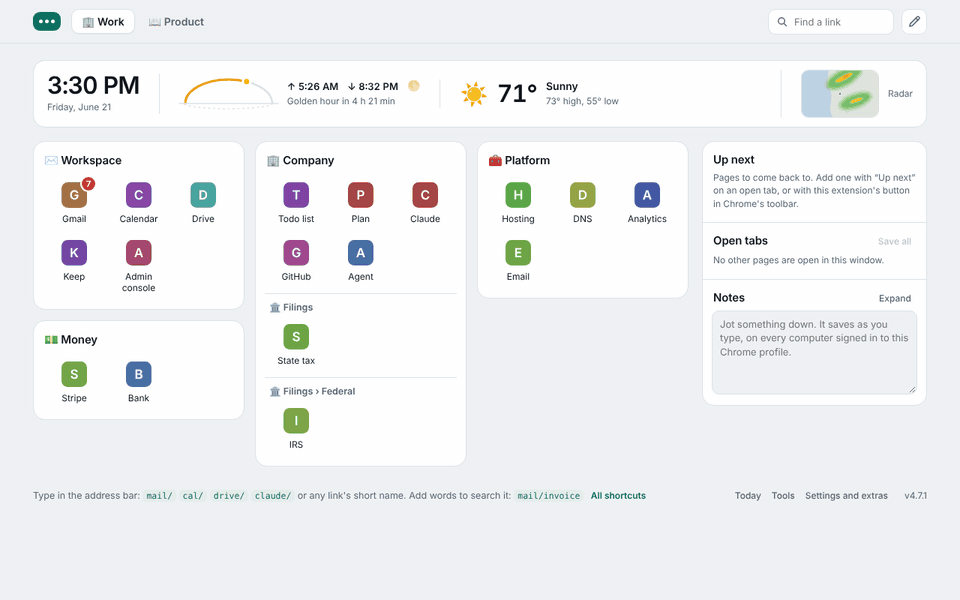
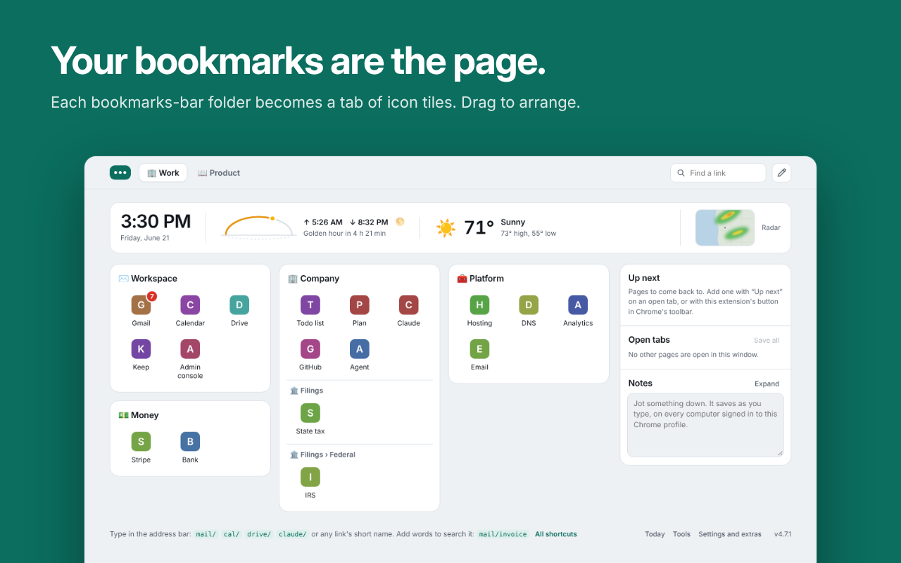
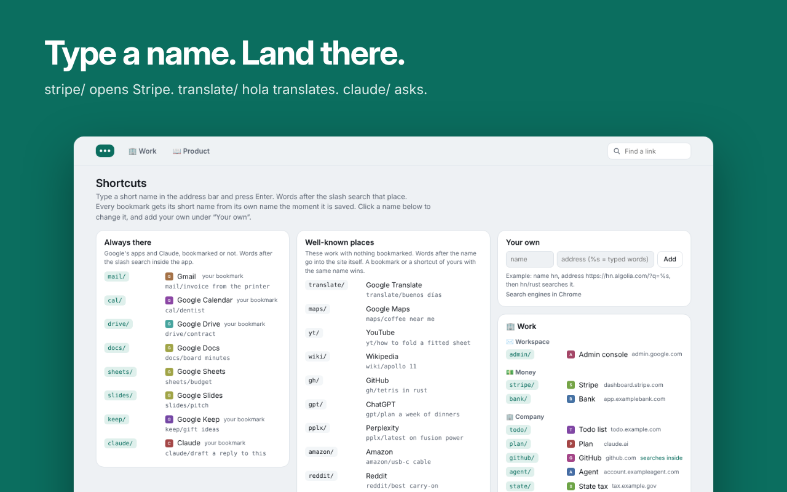
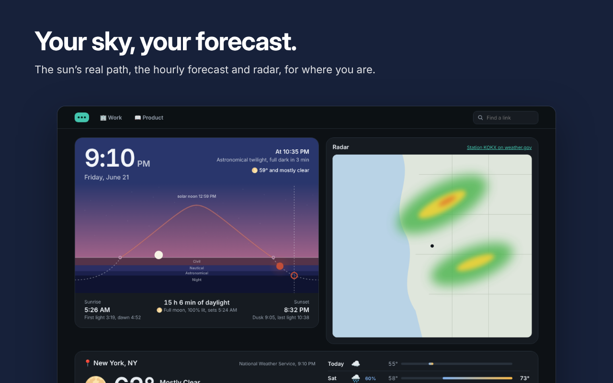
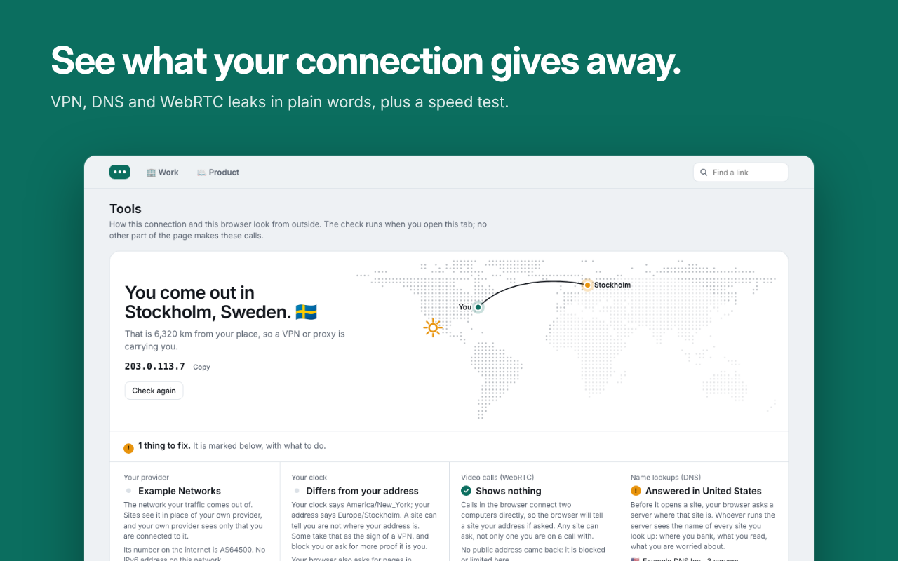
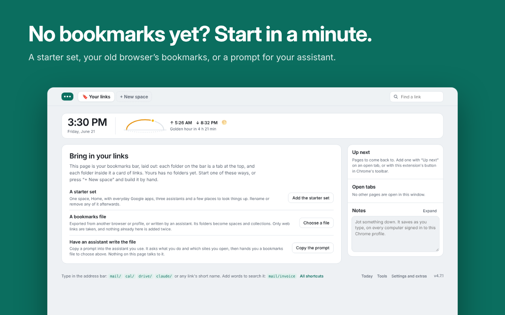

# New Tab

**Your bookmarks, as your new tab.** Tiles you can drag, short names you can type, and the sky
over where you are. Free, no account, nothing to import.



## Your bookmarks are the page

Every folder on your bookmarks bar is a tab; every folder in it is a card of icons. Drag to
arrange and Chrome's bookmarks change with you, so it's the same on every computer you sign in
to, and removing the extension loses nothing.



## Type a name, land there

Every bookmark gets a short name the moment you save it. `stripe/` opens Stripe;
`mail/invoice` searches your mail; `translate/ hola` translates; `claude/ plan a trip` asks.
About thirty well-known sites work with nothing saved. Type them in the address bar or the
search at the top (`/`).



## Your sky, your forecast

The sun's real path across your day, the twilights and the moon in its true phase, with the
hourly forecast, the week and the radar from the National Weather Service. Point along the sky
or the hours to see any moment of the next day. The page goes dark when night falls where you
are.



## Also in the box

- **Up next:** pages to come back to, saved with one click, Alt+Shift+S or a right-click.
- **Open tabs and notes** beside your links: switch, close or file a tab; jot something down.
- **Search everything you keep,** in every space, with your open tabs.
- **Unread mail** as a badge on your Gmail icon.
- **Sites you visit but haven't saved,** if you switch it on, ready to drag into a collection.
- **Tiles or a list,** light, dark or following the sun, and four accents.
- **Tools:** whether your VPN, DNS or WebRTC leaks, in plain words, plus a speed test and
  Chrome's privacy switches.
- **A start for an empty bookmarks bar:** a starter set, your old browser's bookmarks, or a
  prompt for your own assistant.

| | |
|---|---|
|  |  |

## Private by construction

No account, no server, no analytics, no ads. Your links stay Chrome bookmarks. The forecast
gets your place rounded to about a kilometre; the rest is in [PRIVACY.md](PRIVACY.md).

## Install

**From a release (two minutes)**

1. Download `newtab-<version>.zip` from the [latest release](../../releases/latest) and unzip it
   somewhere it can stay, such as your Documents folder.
2. Open `chrome://extensions` and switch on **Developer mode** (top right).
3. Click **Load unpacked** and choose the unzipped folder.
4. Open a new tab. Chrome asks once whether to keep the new page: keep it.

To update, replace the folder's contents with the new release and click ↻ on the extension.

**From source:** clone this repository and load the `extension` folder the same way.

**For a team on Google Workspace:** once it is on the Chrome Web Store (public, unlisted or
private to your domain), force-install it by its ID in the Admin console under Chrome → Apps &
extensions. Pair it with managed bookmarks and every new hire opens a new tab onto the
company's tools. The listing text and assets are in [`store/`](store/listing.md).

New Tab is built and tested on Chrome 120 and later. Other Chromium browsers are untested.

## More

- **[The guide](GUIDE.md):** everything the page does, getting started, permissions, and what
  is deliberately left out.
- **[PRODUCT.md](PRODUCT.md):** why each part is the way it is, and what was tried and cut.
- **[PRIVACY.md](PRIVACY.md):** what is kept and what leaves your browser.

## Next

- **Notes and Up next in Chrome's side panel,** beside whatever page you are on.
- **Forecasts outside the United States.**

## Develop

No build step. The extension is the `extension` folder as it stands.

```
npm install
npx playwright install chromium
npm test            # 13 astronomy checks in Node, then about 210 checks in a real Chromium
npm run shots       # the screenshots in store/screenshots
npm run media       # the captioned store images and the demo in store/media (needs ffmpeg)
npm run zip         # newtab.zip, ready to upload or release
```

To release, raise `version` in `extension/manifest.json` and push to `main`: a workflow zips the
folder and publishes it under that version.

`extension/sky.js` is the astronomy: pure functions, no browser, tested against dates whose
answers are public record (a solstice sunrise in New York, the April 2024 eclipse). The browser
tests load the extension unpacked and exercise the real `chrome.*` APIs with every outside
request stubbed.

## Credits

Sun and moon positions are ported from [SunCalc](https://github.com/mourner/suncalc) by
Volodymyr Agafonkin (BSD 2-Clause); see [THIRD-PARTY.md](extension/THIRD-PARTY.md). Weather and
radar are from the U.S. National Weather Service. City search is © OpenStreetMap contributors.
The approximate place is from BigDataCloud. The dotted map's land is from Natural Earth. The promo film's music is "Happy Beats Business Moves Vol. 11" by Sascha Ende (ende.app, CC BY 4.0); its sounds are Kenney's (CC0). What the product is for, flow by flow, is in
[PRODUCT.md](PRODUCT.md).

## Licence

[MIT](LICENSE). New Tab is a product of Variadic Group LLC.
